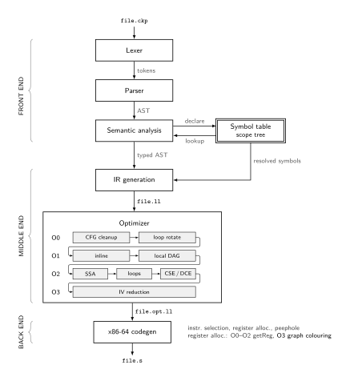

# LLVM-IR-Compiler

A compiler for a subset of C++, written for CSC-305. It turns a `.ckp` source file into LLVM IR. It can then optimize the IR at four levels (`-O0` to `-O3`) and generate x86-64 assembly that `gcc` or `clang` can link.

The compiler is written in C++17. It uses Flex and Bison, and links only LLVM's Support library.

## Commands

You need `flex`, `bison`, `g++`, `llvm-config` and `clang`.

```bash
make                                  # build the compiler: build/parser
make test                             # run every test at -O0, -O1, -O2 and -O3
./run_tests.sh test/test_ir           # run the tests in one folder
./run_tests.sh path/to/file.cpp       # run one file, with any extension
./run_tests.sh test/test_lex -o2 -o3  # run at chosen levels only
make clean                            # delete build/ and outputs/
```

Every file under `test/` is a test, except those in `test/expected/` and `test/inputs/`. A file the compiler rejects only has its errors printed. A file it accepts is compiled at each level and checked:
- the IR is verified after every pass;
- the optimized IR passes clang's verifier;
- the program links and runs, and its output must match `test/expected/<name>.out`, or the output of the unoptimized program when there is none.


| Folder | Tests |
|---|---|
| `test/test_lex/` | literals, comments and operators; two lexical errors |
| `test/test_syntax/` | declarations, control flow, functions, classes and expressions; three syntax errors |
| `test/test_ir/` | arithmetic, arrays and pointers, classes, functions, input, const and namespaces; semantic errors |
| `test/test_codegen/` | integer and floating code, calls, memory, objects, short and float |
| `test/test_optimization/` | one small program per optimization, with FileCheck lines showing its effect |
| `test/test_unsupported/` | every C++ feature the compiler rejects, grouped by kind, one error per feature |

To compile one file:

```bash
./build/parser -O2 file.ckp                   # writes outputs/file/file.ll, file.opt.ll and file.s
gcc outputs/file/file.s -o file && ./file     # link and run the generated program
```

To debug the optimizer:

```bash
./build/parser -O2 --verify-each --trace-passes --dump-callgraph file.ckp
```

- `--verify-each` checks the IR after every pass, and reports the pass that broke it.
- `--trace-passes` writes the IR after each pass to `file.passes.ll`.
- `--dump-callgraph` writes `file.callgraph.txt`.

## Architecture

<p align="center">
  
</p>

## Limitations

- **Types:**
  - `volatile`, `enum`, `union`.
- **Expressions:**
  - the comma operator, C++ casts (`static_cast<T>(x)`), and casts to bare typedef/class names such as `(Dog *)p`. 
- **C++ features not supported:**
  - templates, exceptions;
  - virtual functions, operator overloading, constructor initialiser lists;
  - default arguments;
  - user-defined variadic functions;
  - functions returning references.
- **Libraries:** only `printf` and `scanf` are built in. Other functions are name-mangled, so the compiler cannot call C library functions or link with separately compiled C code.
- **Code generation:**
  - x86-64 Linux (System V ABI) only;
  - structs, classes and lambdas passed or returned by value use a hidden-pointer convention for all sizes (works within compiled code, but small structs do not match System V register-passing with external C code).

## Members

- Adityavardhan Singh (24322005)
- Garima Sidana (24113043)
- Manjot Singh (24116048)
- Naivadhya Garg (24115106)
