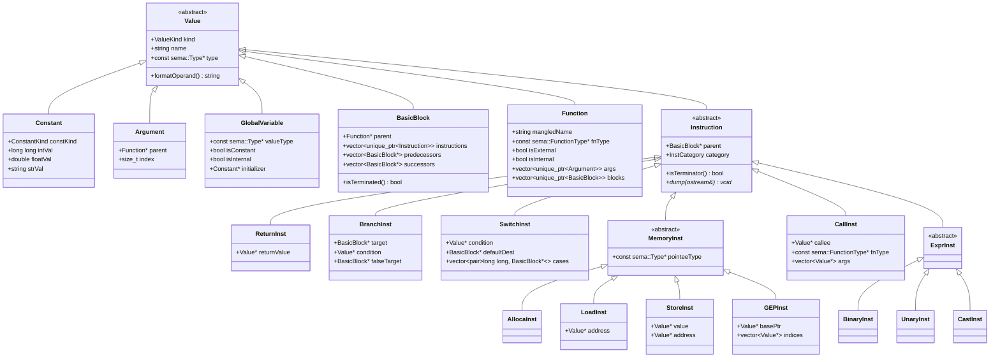
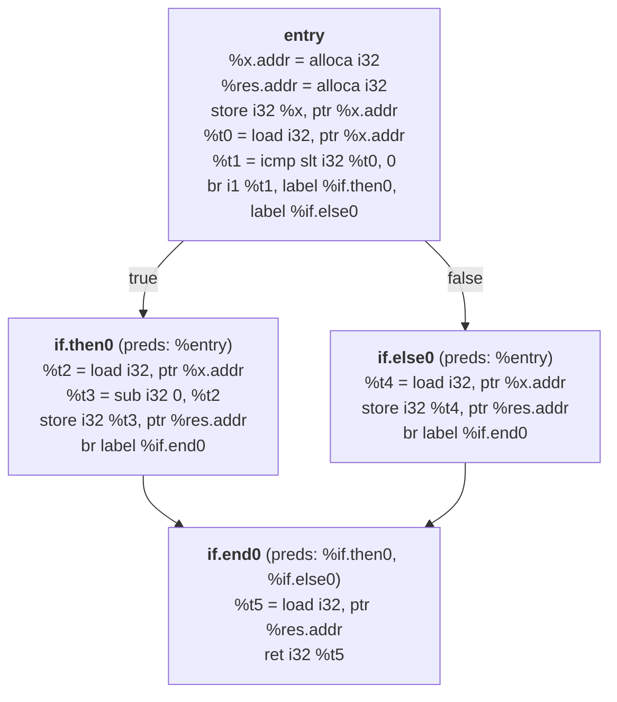

# Intermediate Representation (IR) Architecture & Design Guide

This document is the comprehensive design specification and architectural guide for the Intermediate Representation (`src/ir/`) phase of the compiler. It is written for someone who has read the AST headers (`src/ast/`) and the semantic phase documentation (`docs/semantic-phase.md`) and wants to understand—and explain to anyone else—how the compiler lowers a type-checked AST and `sema::SymbolTable` into an in-memory Control Flow Graph (CFG) and finally into valid textual LLVM IR (`.ll`) modeled after `clang -O0`.

No LLVM core libraries (`llvm::Module`, `llvm::IRBuilder`, `llvm::Type`, `llvm::Value`) are used for IR generation. The entire CFG hierarchy, instruction representation, and `.ll` serializer are implemented from scratch in `src/ir/`.

---

## Table of Contents

1. [Where IR Generation Fits in the Pipeline](#1-where-ir-generation-fits-in-the-pipeline)
2. [Core Philosophy: Why `clang -O0` Stack Slots (`alloca`) Instead of SSA `phi` Nodes](#2-core-philosophy-why-clang--o0-stack-slots-alloca-instead-of-ssa-phi-nodes)
3. [The Tiered In-Memory CFG Class Hierarchy](#3-the-tiered-in-memory-cfg-class-hierarchy)
4. [Why Pointer Instructions Store Explicit `sema::Type*`](#4-why-pointer-instructions-store-explicit-sematype)
5. [Control Flow Graph Mechanics: Predecessors, Successors, and Terminators](#5-control-flow-graph-mechanics-predecessors-successors-and-terminators)
6. [How `IRVisitor` Uses the Symbol Table & Semantic Annotations (With Examples)](#6-how-irvisitor-uses-the-symbol-table--semantic-annotations-with-examples)
7. [Internal State Stacks Inside `IRVisitor`](#7-internal-state-stacks-inside-irvisitor)
8. [Object-Oriented Lowering: Record Layout, Multiple Inheritance, Constructors, and Destructors](#8-object-oriented-lowering-record-layout-multiple-inheritance-constructors-and-destructors)
9. [Dynamic Memory (`new` and `delete`) and the Target-Independent GEP `sizeof` Trick](#9-dynamic-memory-new-and-delete-and-the-target-independent-gep-sizeof-trick)
10. [Lambdas and Closure Lowering](#10-lambdas-and-closure-lowering)
11. [Edge Cases and Pitfalls Caught in Specification](#11-edge-cases-and-pitfalls-caught-in-specification)

---

## 1. Where IR Generation Fits in the Pipeline

The compiler executes five sequential phases. Each phase only runs if all previous phases succeeded with zero errors:

1. **Scanner (`src/lexer.l`)**: Tokenizes the source file and populates the token table.
2. **Parser (`src/parser.y`)**: Builds the Abstract Syntax Tree (`ast::Program`).
3. **SymbolBuilder (`src/semantic/symbolbuilder.*`)**: Builds the persistent scope tree (`sema::SymbolTable`), resolves every `ast::TypeSpec` into a `sema::Type`, handles overload sets, computes `loweredType` for methods, and assigns unique length-prefixed `mangledName`s.
4. **TypeChecker (`src/semantic/typecheck.*`)**: Type-checks all expressions and statements, attaches `Expr::type` and `Expr::isLValue`, resolves `DeclRefExpr::symbol`, `MemberExpr::symbol`, `CallExpr::function`, `GotoStmt::target`, `CaseStmt::constant`, `LambdaExpr::usedCaptures`, and wraps every implicit conversion in an explicit `ast::ImplicitCastExpr` node.
5. **IRGenerator (`src/ir/`)**:
   - `ir::IRVisitor` walks the annotated AST and `sema::SymbolTable` and instructs `ir::IRBuilder` to construct the in-memory Control Flow Graph inside an `ir::Module`.
   - `ir::Module::dump(std::ostream &)` traverses the in-memory CFG and emits `outputs/<name>/<name>.ll`.
   - The test runner (`run.sh`) validates `outputs/<name>/<name>.ll` using `clang -x ir -fsyntax-only`.

### Strict Separation of Concerns
`IRVisitor` **never** re-runs name lookup, overload resolution, access checking, or type inference. It treats the AST annotations and `sema::SymbolTable` as ground truth.

---

## 2. Core Philosophy: Why `clang -O0` Stack Slots (`alloca`) Instead of SSA `phi` Nodes

### 2.1 The Apparent Paradox: "Non-SSA CFG" vs. Valid `.ll` Files
In true Static Single Assignment (SSA) form, a source variable `x` that is modified in two branches of an `if-else` statement requires a $\phi$ (`phi`) node at the join block:

```llvm
; True SSA form (clang -O1 / mem2reg) — NOT what we do:
if.then:
  %x.1 = add i32 %x.0, 1
  br label %if.end
if.else:
  %x.2 = sub i32 %x.0, 1
  br label %if.end
if.end:
  %x.3 = phi i32 [ %x.1, %if.then ], [ %x.2, %if.else ]
```

Constructing minimal SSA with $\phi$ nodes directly from an AST requires computing dominance frontiers (Cytron's algorithm) or Braun's on-the-fly SSA reconstruction, which is complicated by arbitrary `goto` jumps and `switch` fallthroughs.

Instead, `clang -O0` uses the **Stack-Slot (`alloca` / `load` / `store`) Model**:
- **Every mutable C++ variable** (parameters, local variables) is allocated a slot on the function's stack frame using `alloca`.
- **The variable's address** (`%x.addr = alloca i32`) never changes! Writing to `x` emits a `store` to `%x.addr`. Reading `x` emits a `load` from `%x.addr` into a fresh, single-use virtual register (`%t0`, `%t1`, ...).
- **Every temporary / rvalue** produced by an expression (`a + b`, function call return, loaded value) is placed in a unique virtual register (`%t2 = add i32 %t0, %t1`).

```llvm
; Our clang -O0 style (Zero phi nodes):
entry:
  %x.addr = alloca i32
  store i32 10, ptr %x.addr
  ...
if.then:
  %t0 = load i32, ptr %x.addr
  %t1 = add i32 %t0, 1
  store i32 %t1, ptr %x.addr
  br label %if.end
if.else:
  %t2 = load i32, ptr %x.addr
  %t3 = sub i32 %t2, 1
  store i32 %t3, ptr %x.addr
  br label %if.end
if.end:
  %t4 = load i32, ptr %x.addr
```

### 2.2 Why All `alloca` Instructions Are Hoisted to the `entry` Basic Block
Suppose a C++ function contains a `goto` or `switch` that jumps over or into a block where a local variable is declared, or declares a variable inside a `while` loop:
1. **Stack Overflow Prevention**: If `alloca` is emitted inside a loop body basic block, the CPU stack pointer grows on every iteration of the loop, eventually crashing the program.
2. **LLVM Dominance Rule**: In LLVM IR, every use of a register `%x.addr` must be *dominated* by its definition. The `entry` block of a function dominates **every** reachable basic block in that function.

Therefore, `ir::Function` maintains a dedicated insertion point at the top of its `entry` block. Whenever `IRBuilder::createEntryAlloca(fn, type, name)` is called—even when `IRVisitor` is currently inside a deeply nested loop or `if` branch—the `AllocaInst` is placed at the top of `entry`, while the initializer's `StoreInst` is emitted at the current basic block position.

---

## 3. The Tiered In-Memory CFG Class Hierarchy

The IR is organized into two main layers inside namespace `ir`:
1. **Graph Containers**: `Module`, `Function`, `BasicBlock`
2. **Values & Instructions**: `Value` and its derived classes (`Constant`, `Argument`, `GlobalVariable`, `BasicBlock`, `Instruction`).



### Why Instructions Are Split into Four Distinct Categories
In the initial rough idea, instructions were grouped into Return, Branch, and Expression instructions. Upon closer inspection, grouping memory operations (`alloca`, `load`, `store`, `getelementptr`) and function calls (`call`) inside `ExprInst` blurs an important boundary:
- **`ExprInst` (`BinaryInst`, `UnaryInst`, `CastInst`)**: Pure value computations on virtual registers. They take register/constant operands, have no side effects on memory or control flow, and **always** produce a virtual register value (`%t0 = add i32 %a, %b`).
- **`MemoryInst` (`AllocaInst`, `LoadInst`, `StoreInst`, `GEPInst`)**: Interact with addresses and memory layout. Unlike pure expressions:
  - `StoreInst` produces **no value** (`void` result, no `%reg =` prefix).
  - Every `MemoryInst` requires knowing the **pointee / element `sema::Type*`** in addition to the opaque pointer (`ptr`) operand.
- **`CallInst`**: Transfers control to a callee (direct `@func` or indirect `%fn_ptr`), may return `void` (no `%reg =` assignment) or a value, and for variadic functions (`printf`, `scanf`) must emit the full function signature `i32 (ptr, ...)` in the call instruction.
- **Terminators (`ReturnInst`, `BranchInst`, `SwitchInst`)**: End a `BasicBlock` and define the directed edges of the Control Flow Graph.

---

## 4. Why Pointer Instructions Store Explicit `sema::Type*`

Since LLVM 15, textual LLVM IR uses **opaque pointers**: every pointer type—whether `int*`, `int**`, `Dog*`, or `int (*)[10]`—is spelled simply as `ptr`.

However, LLVM instructions that allocate, dereference, or offset a pointer **must** still spell out the underlying element type in the instruction text:
- `alloca`: `%p = alloca i32` or `%d = alloca %class.Dog`
- `load`: `%v = load i32, ptr %p`
- `store`: `store i32 %v, ptr %p`
- `getelementptr`: `%el = getelementptr inbounds [10 x i32], ptr %arr, i64 0, i64 %idx`

Because our IR reuses `const sema::Type*` from `src/semantic/types.h` (where `PointerType` retains its `const sema::Type *pointee`), and because `MemoryInst` explicitly stores `const sema::Type *pointeeType` (the allocated type for `AllocaInst`, the loaded value type for `LoadInst`, the stored value type for `StoreInst`, and the base element type being indexed for `GEPInst`), our IR generator never loses pointee type information.

> [!NOTE]
> `sema::toLLVMType` and `sema::toLLVMRecord` in `src/semantic/types.cpp` exist only for the `-symbols.txt` debug dump. The IR module in `src/ir/` implements its own dedicated type formatter (`ir::formatType(const sema::Type *)` and `ir::formatRecordDef(const sema::RecordSymbol *)`) so that IR serialization is completely self-contained inside `src/ir/`.

---

## 5. Control Flow Graph Mechanics: Predecessors, Successors, and Terminators

### 5.1 What Makes `BasicBlock` a Graph Node
Each `ir::BasicBlock` stores two adjacency vectors:
```cpp
std::vector<BasicBlock *> predecessors;
std::vector<BasicBlock *> successors;
```
Whenever `IRBuilder` appends a branch or switch terminator to the current block `currBB`:
- **`createBr(targetBB)`**:
  Adds `targetBB` to `currBB->successors` and `currBB` to `targetBB->predecessors`.
- **`createCondBr(cond, trueBB, falseBB)`**:
  Adds `trueBB` and `falseBB` to `currBB->successors`, and adds `currBB` to `trueBB->predecessors` and `falseBB->predecessors`.
- **`createSwitch(cond, defaultBB, cases)`**:
  Links `currBB` with `defaultBB` and every unique `caseBB` in `cases`.

### 5.2 Concrete Example: `if-else` Control Flow Graph
Consider:
```cpp
int absVal(int x) {
    int res;
    if (x < 0) {
        res = -x;
    } else {
        res = x;
    }
    return res;
}
```
The CFG constructed in memory has 4 `BasicBlock` nodes (`entry`, `if.then0`, `if.else0`, `if.end0`):



### 5.3 Handling Post-Terminator Dead Code & Empty Merge Blocks
In C++, a programmer can write:
```cpp
int classify(int n) {
    if (n < 0) {
        return -1;
    } else {
        return 1;
    }
} // <-- What happens to if.end0 here?
```
Notice what happens in `classify` (from `test1_control_flow.ckp`):
1. `if.then0` emits `ret i32 -1`. It is now **terminated** (`if.then0->isTerminated() == true`). It does **not** emit `br label %if.end0`.
2. `if.else0` emits `ret i32 1`. It is also **terminated**, so it does **not** emit `br label %if.end0`.
3. Now `IRVisitor` switches the insertion point to `if.end0`. Because neither branch jumped to `if.end0`, **`if.end0->predecessors` is empty** (`if.end0->predecessors.empty() == true`) and `if.end0->instructions` is empty!
4. If we emitted an empty `if.end0:` label at the end of `@global_8classify_i`, `clang` would reject the `.ll` file because every `BasicBlock` in LLVM IR must contain at least one instruction and end with a terminator.
5. **How the CFG solves this cleanly**:
   - Before emitting any instruction in `IRBuilder`, if `insertBlock == nullptr` or `insertBlock->isTerminated()`, the instruction is suppressed (it is unreachable code after a `return`/`break`/`continue`/`goto`).
   - At the end of `Function` body generation:
     - If a non-entry `BasicBlock` is completely empty and has `predecessors.empty()`, it is removed from `Function::blocks`.
     - If the final `BasicBlock` is reachable (either it is `entry` or `!predecessors.empty()`) and `!isTerminated()`, `IRBuilder` appends a fallback terminator: `ret void` for `void` functions/constructors/destructors, `ret i32 0` for `main` (per C++ standard `[basic.start.main]`), or `ret <default_zero>` for non-void functions where control reaches the end without a return.

---

## 6. How `IRVisitor` Uses the Symbol Table & Semantic Annotations (With Examples)

This section explains the exact contract between the semantic phase (`src/semantic/`) and the IR generator (`src/ir/`). Every row in the summary table below is followed by a concrete C++ snippet and the exact LLVM IR our generator emits.

### 6.1 Summary Matrix: What Sema Provides vs. What IR Emits

| # | Language Construct | AST / SymbolTable Source | What `IRVisitor` Extracts | What `IRBuilder` / `Module` Emits |
| :- | :--- | :--- | :--- | :--- |
| **1** | **Struct / Class Definitions** | `SymbolTable::global()` scope tree (`SymbolKind::Record`) | `RecordSymbol::mangledName`, `isClass`, `bases`, `fields` | `%struct.Point = type { i32, i32 }`<br/>`%class.Bar = type { %class.Foo, i32, i32 }` |
| **2** | **Global & Static Member Vars** | `Scope::symbols` (`SymbolKind::Variable` in `Global` or `Record` scope) | `Symbol::mangledName`, `Symbol::type`, `Symbol::isStatic`, `VarDecl::init` | `@global_9instances = internal global i32 0`<br/>`@class_6Animal_7created = global i32 0` |
| **3** | **Function & Method Signatures** | `FunctionDecl::symbol` (` sema::FunctionSymbol`) | `mangledName`, `loweredType` (already includes `ptr %this` for non-static methods!), `isStatic`, `definition` | `define i32 @global_3add_ii(i32 %a, i32 %b)`<br/>`define void @class_3Foo_5setId_i(ptr %this, i32 %v)` |
| **4** | **Function Parameters & Locals** | `ParamDecl::symbol`, `DeclStmt` -> `VarDecl::symbol` | `Symbol*` key, `Symbol::type`, `Symbol::isStatic` | Hoisted `%x.addr = alloca <ty>` in `entry` block; mapped in `namedValues[Symbol*]` |
| **5** | **Static Local Variables** | `VarDecl::symbol` (`isStatic == true` inside `Function`/`Block` scope) | `Symbol::name`, enclosing `FunctionSymbol::mangledName`, `VarDecl::init` | `@main.calls.0 = internal global i32 0` (mapped in `namedValues[Symbol*]` as global address) |
| **6** | **Variable / Parameter Lookup** | `DeclRefExpr::symbol` | Looks up `node->symbol` in `namedValues` or `globalValues`; checks if `SymbolKind::Field` | Returns `alloca` or `@global` pointer; if `Field`, emits GEP from `%this` |
| **7** | **LValue-to-RValue Evaluation** | `Expr::isLValue` and `Expr::type` | Distinguishes address computation (`emitLValue`) from value loading (`emitRValue`) | `emitRValue` calls `emitLValue(e)` then emits `%t = load <ty>, ptr %addr` |
| **8** | **Implicit Type Conversions** | `ImplicitCastExpr::castKind`, `sub->type`, `node->type` | Exact cast kind (`IntegralCast`, `ToBool`, `ArrayToPointer`, `DerivedToBase`, etc.) | `sext`/`zext`/`trunc`, `sitofp`/`fptosi`, `icmp ne`, `getelementptr` |
| **9** | **Struct Field & Base Access** | `MemberExpr::symbol` (`SymbolKind::Field`), `RecordSymbol::bases` & `fields` | Owner `RecordSymbol*` of field; base subobject path + `bases.size() + fieldIdx` | Chain of `getelementptr inbounds %Record, ptr %base, i32 0, i32 <idx>` |
| **10** | **Direct, Method & Indirect Calls** | `CallExpr::function` (or `callee->type` if null) | If `function != nullptr`: `mangledName` + `loweredType`; if `ClosureType`: closure fn; else function pointer | `call <ret> @mangled(ptr %this, ...)` or indirect `call <ret> %fn_ptr(...)` |
| **11** | **Labels, `goto`, and `switch`** | `GotoStmt::target` (`LabelStmt*`), `CaseStmt::constant` | Target `LabelStmt*` pointer; pre-evaluated `long long` case constant | Maps `LabelStmt* -> BasicBlock*`; populates `SwitchInst` case table |
| **12** | **Constructors & Initializers** | `VarDecl::constructor`, `NewExpr::constructor`, `InitListExpr::constructor` | Resolved `FunctionSymbol*` (or `nullptr` for aggregate/trivial initialization) | Emits `call void @class_..._C_...(ptr %obj, ...)` or element-wise GEP stores |
| **13** | **Lambdas & Captures** | `LambdaExpr::type` (`ClosureType`), `LambdaExpr::usedCaptures` | Capture list (`ByCopy`, `ByRef`, `This`) and deduced `ClosureType::signature` | Synthesizes `%closure.L.C` struct, populates captures, defines `@__lambda_L_C` |

---

### 6.2 Detailed Code-to-IR Walkthroughs for Each Row

#### Row 1: Struct and Class Type Definitions (Including Inheritance)
`RecordSymbol` stores `bases` (`std::vector<BaseClass>`) and `fields` (`std::vector<Symbol *>`). `IRVisitor` walks the `SymbolTable` scope tree in declaration order and registers every `RecordSymbol` in `ir::Module`.
- **Source C++ (`test7_all_features.ckp`)**:
  ```cpp
  struct Point { int x; int y; };
  class Foo { public: int m_id; protected: int m_level; bool m_filled; private: int m_serial; };
  class Bar : public Foo { private: int m_width; int m_height; };
  ```
- **Emitted `.ll`**:
  ```llvm
  %struct.Point = type { i32, i32 }
  %class.Foo = type { i32, i32, i1, i32 }
  %class.Bar = type { %class.Foo, i32, i32 }
  ```
  Notice how `%class.Bar` places its base class subobject `%class.Foo` at index `0`, followed by `m_width` at index `1` and `m_height` at index `2`.

#### Row 2 & Row 5: Global Variables, Static Class Members, and Static Locals
- **Source C++ (`test17_brace_static_multidim.ckp`)**:
  ```cpp
  static int instances = 0;
  static int limit{10};
  class Counter { public: static int total; };
  int Counter::total = 0;
  int main() {
      static int calls = 0;
      calls++;
  }
  ```
- **How `IRVisitor` handles it**:
  - `instances` has `Symbol::mangledName = "global_9instances"` and `isStatic = true` (file-scope static -> `internal global`).
  - `Counter::total` has `Symbol::mangledName = "class_7Counter_5total"` (`global`).
  - `calls` inside `main` has `SymbolKind::Variable` and `isStatic = true` inside a `Function`/`Block` scope. `IRVisitor` creates an internal global `@main.calls.0 = internal global i32 0` and stores that global `Value*` in `namedValues[calls->symbol]`.
- **Emitted `.ll`**:
  ```llvm
  @global_9instances = internal global i32 0
  @global_5limit = internal global i32 10
  @class_7Counter_5total = global i32 0
  @main.calls.0 = internal global i32 0
  ```

#### Row 3 & Row 4: Function Parameters, Reference Parameters, and Entry `alloca`s
- **Source C++ (`test7_all_features.ckp`)**:
  ```cpp
  void swap(int &a, int &b) {
      int t = a;
      a = b;
      b = t;
  }
  ```
- **How `IRVisitor` uses `SymbolTable`**:
  - `swap`'s `FunctionSymbol` has `mangledName = "global_4swap_RiRi"` and `loweredType = void (int&, int&)`.
  - In LLVM IR, `ReferenceType(int)` lowers to `ptr`.
  - For a normal value parameter `int x`, `IRVisitor` creates `%x.addr = alloca i32` and stores `%x` into `%x.addr`.
  - For a **reference parameter** `int &a`, the incoming argument `%a` is already the `ptr` to the caller's object! We still allocate `%a.addr = alloca ptr` and store `ptr %a` into `%a.addr` (just like `clang -O0`). When `a` is accessed as an LValue, `IRVisitor` loads the `ptr` from `%a.addr`!
- **Emitted `.ll`**:
  ```llvm
  define void @global_4swap_RiRi(ptr %a, ptr %b) {
  entry:
    %a.addr = alloca ptr
    %b.addr = alloca ptr
    %t.addr = alloca i32
    store ptr %a, ptr %a.addr
    store ptr %b, ptr %b.addr
    %t0 = load ptr, ptr %a.addr
    %t1 = load i32, ptr %t0
    store i32 %t1, ptr %t.addr
    %t2 = load ptr, ptr %b.addr
    %t3 = load i32, ptr %t2
    %t4 = load ptr, ptr %a.addr
    store i32 %t3, ptr %t4
    %t5 = load i32, ptr %t.addr
    %t6 = load ptr, ptr %b.addr
    store i32 %t5, ptr %t6
    ret void
  }
  ```

#### Row 6 & Row 7: `emitLValue` vs. `emitRValue` (The Dual Evaluation Model)
Every expression in C++ is evaluated either for its **memory location (`emitLValue`)** or for its **value (`emitRValue`)**:
- When evaluating `a = b + 1`:
  - The left-hand side `a` of `AssignExpr` is evaluated with **`emitLValue(node->target)`**, which returns `%a.addr` (`ptr`).
  - The right-hand side `b + 1` is evaluated with **`emitRValue(node->value)`**:
    - Inside `b + 1`, `b` is a `DeclRefExpr` with `isLValue = true`. Because `emitRValue` was requested on an lvalue expression, `emitRValue` calls `Addr = emitLValue(b)` (`%b.addr`) and then emits `%t0 = load i32, ptr %b.addr`!
    - Then `BinaryInst` emits `%t1 = add i32 %t0, 1`.
  - Finally, `AssignExpr` emits `store i32 %t1, ptr %a.addr` and returns `%a.addr` (if used as an LValue) or `%t1` (if used as an RValue).

| Expression Node | What `emitLValue(node)` Returns | What `emitRValue(node)` Returns |
| :--- | :--- | :--- |
| `DeclRefExpr` (`int x`) | `%x.addr` (`ptr` from `namedValues[sym]`) | `load i32, ptr %x.addr` |
| `DeclRefExpr` (`int &r`) | `load ptr, ptr %r.addr` (the referee's address!) | `load i32, ptr %ref_addr` |
| `UnaryExpr(*p)` (`Deref`) | `emitRValue(p)` (the pointer value itself is the address of `*p`!) | `load <pointee>, ptr (emitRValue(p))` |
| `UnaryExpr(&x)` (`AddrOf`) | *(Not an LValue)* | `emitLValue(x)` (the address of `x` IS the rvalue of `&x`!) |
| `ArraySubscriptExpr(a[i])` | `getelementptr <elem_ty>, ptr (emitRValue(a)), i32 (emitRValue(i))` | `load <elem_ty>, ptr (emitLValue(a[i]))` |
| `MemberExpr(s.f / p->f)` | `getelementptr %Struct, ptr %base, i32 0, i32 <idx>` | `load <field_ty>, ptr (emitLValue(s.f))` |

#### Row 8: Lowering `ImplicitCastExpr` (All 10 `CastKind`s)
Because `TypeChecker` already inserted an `ast::ImplicitCastExpr` node for every implicit conversion in the source program, `IRVisitor::visitImplicitCastExpr` simply switches on `node->castKind`:

| `ast::CastKind` | Source `sub->type` -> Target `node->type` | Emitted LLVM Instruction |
| :--- | :--- | :--- |
| `IntegralCast` | `bool` (`i1`) -> `int` (`i32`) or `char` (`i8`) | `zext i1 %v to i32` (bool is unsigned `0`/`1`) |
| `IntegralCast` | `char` (`i8`) -> `int` (`i32`) | `sext i8 %v to i32` (signed char promotion) |
| `IntegralCast` | `int` (`i32`) -> `char` (`i8`) | `trunc i32 %v to i8` |
| `IntegralToFloating` | `bool` (`i1`) -> `float`/`double` | `uitofp i1 %v to float/double` |
| `IntegralToFloating` | `char`/`int` -> `float`/`double` | `sitofp i32 %v to float/double` |
| `FloatingToIntegral` | `float`/`double` -> `char`/`int` | `fptosi double %v to i32` |
| `FloatingCast` | `float` -> `double` | `fpext float %v to double` |
| `FloatingCast` | `double` -> `float` | `fptrunc double %v to float` |
| `ToBool` | `bool` (`i1`) -> `bool` (`i1`) | `%v` (no-op) |
| `ToBool` | `char`/`int` -> `bool` (`i1`) | `icmp ne i32 %v, 0` |
| `ToBool` | `float`/`double` -> `bool` (`i1`) | `fcmp une double %v, 0.000000e+00` |
| `ToBool` | `ptr` / `null` -> `bool` (`i1`) | `icmp ne ptr %v, null` |
| `ArrayToPointer` | `T[N]` (`[N x T]`) -> `T*` (`ptr`) | `%addr = emitLValue(sub)` -> `getelementptr inbounds [N x T], ptr %addr, i64 0, i64 0` |
| `FunctionToPointer` | `FunctionType` -> `PointerType(FunctionType)` | `@mangled_fn` (function symbol address is already `ptr`) |
| `NullToPointer` | `null` -> `T*` (`ptr`) | `Constant::getNull(node->type)` (`null`) |
| `PointerToVoid` | `T*` (`ptr`) -> `void*` (`ptr`) | `%v` (no-op under opaque `ptr`, updates `Value::type` wrapper) |
| `DerivedToBase` | `Derived*` / `Derived&` / `Derived` -> `Base` | Chain of `getelementptr inbounds %Derived, ptr %p, i32 0, i32 <base_idx>` along inheritance path |

---

## 7. Internal State Stacks Inside `IRVisitor`

A frequently asked question in compiler design courses is: *"Why does `IRVisitor` need stacks of active loops, switches, and block scopes while walking the AST?"*

Because C++ allows **nested** control flow constructs (`for` inside `while`, `switch` inside `for`, blocks inside blocks) and non-local jumps (`break`, `continue`, `return`, `goto`), a child AST node like `BreakStmt` has no pointer to the `WhileStmt` or `SwitchStmt` it breaks out of. The visitor must track enclosing control-flow targets on stacks:

### 7.1 `breakStack` and `continueStack` (The Loop / Switch Stacks)
- **What they store**:
  - `continueStack`: `std::vector<ir::BasicBlock *>` — target block for `continue;`
  - `breakStack`: `std::vector<ir::BasicBlock *>` — target block for `break;`
- **Why two separate stacks (or a `BreakContinueTarget` struct)**:
  - A **`while` / `do-while` / `for` loop** pushes **both** a `continue` target and a `break` target:
    - In `while (cond) body`: `continue` jumps to `while.cond`; `break` jumps to `while.end`.
    - In `do body while (cond)`: `continue` jumps to `do.cond`; `break` jumps to `do.end`.
    - In `for (init; cond; inc) body`: `continue` jumps to **`for.inc`** (NOT `for.cond`! Otherwise `i++` would be skipped on `continue`, causing an infinite loop!); `break` jumps to `for.end`.
  - A **`switch (cond) body`** statement pushes **only** a `break` target (`switch.end`), leaving `continueStack` untouched!
    - Why? Because in C/C++, writing `continue;` inside a `switch` that is nested inside a `for` loop continues the **enclosing `for` loop**, whereas `break;` inside that `switch` exits the **`switch`**!

```cpp
// Example in test1 / test7: continue inside a loop vs break inside a switch
for (int i = 0; i < 10; i++) {       // pushes continue -> for.inc, break -> for.end
    switch (mode) {                  // pushes break -> switch.end (continue stays for.inc!)
        case 1:
            if (skip) continue;      // jumps to for.inc!
            break;                   // jumps to switch.end!
    }
}
```

### 7.2 `switchStack` (Case & Default Registration)
In C/C++, `CaseStmt` (`case 1:`) and `DefaultStmt` (`default:`) are AST nodes nested inside the `CompoundStmt` body of a `SwitchStmt`—they can even be nested inside inner `{ }` blocks or `case 3: case 4:` fallthrough chains (`test5_switch_literals.ckp`):
```cpp
switch (dec) {
    case 3:
    case 4:
        dec = 300;
        break;
    default:
        dec = 0;
}
```
Notice how the parser builds `case 3: case 4: dec = 300;`:
- `CaseStmt(3)` has `sub = CaseStmt(4)`!
- When `visitSwitchStmt` runs:
  1. It evaluates `cond`, creates `switch.end` and a placeholder `SwitchInst`, and pushes a `SwitchContext { SwitchInst *inst, BasicBlock *defaultBB }` onto `switchStack`.
  2. When `visitCaseStmt(node)` runs, it creates a new `BasicBlock` `sw.case`, if the current block is not terminated it emits a **fallthrough branch** `br label %sw.case`, switches the builder to `sw.case`, registers `(node->constant, sw.case)` on `switchStack.back().inst`, and visits `node->sub`.
  3. Because `case 3:` visits its child `case 4:`, `case 3`'s block automatically falls through (`br label %sw.case.4`) into `case 4`'s block!

### 7.3 Short-Circuit Evaluation (`&&`, `||`) and Ternary (`?:`)
Why can't `a && b` simply evaluate `lhs = emitRValue(a)`, `rhs = emitRValue(b)`, and emit `and i1 %lhs, %rhs`?
Because in C/C++, `&&` and `||` **short-circuit**: in `ptr != null && ptr->x > 0`, evaluating `ptr->x` when `ptr == null` segfaults!
Therefore, `a && b` is lowered using control flow and an entry `alloca i1`:
```llvm
  ; %res.addr = alloca i1 (hoisted in entry)
  %lhs = <evaluate a as i1>
  br i1 %lhs, label %land.rhs, label %land.short

land.short:
  store i1 false, ptr %res.addr
  br label %land.end

land.rhs:
  %rhs = <evaluate b as i1>
  store i1 %rhs, ptr %res.addr
  br label %land.end

land.end:
  %result = load i1, ptr %res.addr
```
This produces 100% valid `-O0` IR without any `phi` node!

---

## 8. Object-Oriented Lowering: Record Layout, Multiple Inheritance, Constructors, and Destructors

### 8.1 Record Layout and Base Subobject GEP Adjustment
When a class `Derived` inherits from one or more base classes (`class Registered : public Animal, public Trackable` in `test4_oop_features.ckp`), its LLVM struct layout places every direct base class first, followed by `Derived`'s own non-static fields:

```text
%class.Animal     = type { i32, i32, i32 }          ; age (0), legs (1), secretId (2)
%class.Trackable  = type { i32 }                    ; serial (0)
%class.Registered = type { %class.Animal,           ; index 0: base Animal
                           %class.Trackable,        ; index 1: base Trackable
                           i32 }                    ; index 2: own field 'slot'
```

#### Case A: Accessing `registered.slot` (Own Field)
- `slot` is index `0` in `Registered::fields`.
- `Registered::bases.size()` is `2`.
- GEP index in `%class.Registered` is `2 + 0 = 2`:
  ```llvm
  %slot.ptr = getelementptr inbounds %class.Registered, ptr %registered.addr, i32 0, i32 2
  ```

#### Case B: Accessing `registered.serial` (Inherited Field from Second Base `Trackable`)
- `MemberExpr::symbol` is `Trackable::serial` (`symbol->parentRecord == Trackable`).
- The base object expression `registered` has type `RecordType(Registered)`.
- Since `Registered != Trackable`, `IRVisitor::emitDerivedToBasePtr` recursively searches `Registered::bases` to find the inheritance path from `Registered` to `Trackable`:
  - `Registered::bases[1].record == Trackable` -> step index `1`.
- First, `IRVisitor` emits a GEP to adjust `ptr %registered.addr` from `Registered*` to its `Trackable` base subobject:
  ```llvm
  %base.trackable = getelementptr inbounds %class.Registered, ptr %registered.addr, i32 0, i32 1
  ```
- Second, it indexes `serial` (field `0` of `Trackable`, which has `0` bases -> index `0 + 0 = 0`):
  ```llvm
  %serial.ptr = getelementptr inbounds %class.Trackable, ptr %base.trackable, i32 0, i32 0
  ```

#### Case C: Calling an Inherited Method `d.setAge(5)` (`Dog : public Animal`)
- `CallExpr::function` is `Animal::setAge`, whose `loweredType` is `void (Animal*, int)`.
- The object `d` is a `Dog`. Before passing `&d` as the `this` pointer (`arg 0`), `IRVisitor` adjusts `&d` from `Dog*` to `Animal*` using the exact same `emitDerivedToBasePtr` helper:
  ```llvm
  %base.animal = getelementptr inbounds %class.Dog, ptr %d.addr, i32 0, i32 0
  call void @class_6Animal_6setAge_i(ptr %base.animal, i32 5)
  ```

### 8.2 C++ Standard Constructor & Destructor Execution Order
In C++, object construction and destruction follow strict deterministic rules:

1. **Construction Order (`Base` -> `Member Initializers` -> `Constructor Body`)**:
   When any constructor `C::C(...)` runs on `ptr %this`:
   - **Direct Bases First**: For each base `B_i` in `C->bases` (index `0 .. k-1`), adjust `%this` via GEP (`i32 0, i32 i`) and call `B_i`'s default constructor (if `B_i` has a default constructor or synthesized default initializer).
   - **Non-Static Data Members Second**: For each field `F_j` in `C->fields` (index `0 .. m-1`), compute `%field.ptr = getelementptr %C, ptr %this, i32 0, i32 (k + j)`:
     - If `F_j`'s `ast::VarDecl` has an in-class initializer (like `int start{0};` in `Counter` in `test17`), evaluate that initializer and store it into `%field.ptr`.
     - Otherwise, if `F_j` is a record type with a default constructor, invoke that default constructor on `%field.ptr` (or loop over elements if `F_j` is an array of records).
   - **Constructor Body Last**: Emit the statements in `C::C`'s `CompoundStmt` body.

2. **Defaulted (`= default`) Constructors/Destructors When Declared Without Body**:
   In `test4_oop_features.ckp`, `Animal()`, `Animal(int)`, `Animal(int, int)`, and `~Animal()` are declared inside `class Animal` without an out-of-class body. Per the course specification, constructors/destructors declared without a definition are treated as `= default` (`Animal() = default;`), so `IRVisitor` synthesizes a trivial body (performing base/field initialization and `ret void`).

3. **Destruction Order (`Destructor Body` -> `Member Destructors in Reverse` -> `Base Destructors in Reverse`)**:
   - **Inside `C::~C(ptr %this)`**:
     1. Emit the statements in `~C`'s body.
     2. For each field `F_j` in **reverse** order (`m-1` down to `0`), if `F_j` is a record with a destructor, call `~FieldType(%field.ptr)`.
     3. For each base `B_i` in **reverse** order (`k-1` down to `0`), GEP to base `i` and call `~B_i(%base.ptr)`.
   - **Automatic Local Object Destruction (RAII on Scope Exit)**:
     - Whenever a local variable `VarDecl` of `RecordType` (or array of `RecordType`) is declared in a block scope and its record has a destructor (user-declared or synthesized because a base/member has a destructor), `IRVisitor` pushes `(varAllocaPtr, recordType)` onto `scopeCleanupStack.back()`.
     - At the end of a `CompoundStmt` (or `ForStmt`), if the current block is not already terminated, `IRVisitor` pops the scope and emits destructor calls in **reverse declaration order (LIFO)**.
     - Before emitting `return`, `break`, `continue`, or `goto`, `IRVisitor` emits destructor calls for all active scopes being exited (for `return`, all scopes up to the function root; for `break`/`continue`, all scopes up to the target loop/switch scope) **without** popping the stack (since subsequent sibling branches still need the scope stack intact).

---

## 9. Dynamic Memory (`new` and `delete`) and the Target-Independent GEP `sizeof` Trick

### 9.1 How `sizeof(T)` Is Computed Without `llvm::DataLayout`
Our compiler does not hardcode target ABI struct padding or use `llvm::DataLayout`. Instead, it uses LLVM IR's canonical target-independent `getelementptr` `null` trick:
- In LLVM, `null` is address `0`.
- `getelementptr <Type>, ptr null, i64 1` asks LLVM to compute the address of element `1` of an array of `<Type>` starting at address `0`. That address is numerically equal to $\text{sizeof}(\text{Type})$ in bytes, including all alignment padding!
- Converting that pointer to an integer with `ptrtoint ptr %gep to i64` yields the exact byte size to pass to `@malloc(i64)`.

#### Example 1: Single Object Allocation (`Bar *barPtr = new Bar;`)
```llvm
  %t0 = getelementptr %class.Bar, ptr null, i64 1
  %t1 = ptrtoint ptr %t0 to i64
  %t2 = call ptr @malloc(i64 %t1)
  ; If Bar has a constructor, invoke it on %t2:
  call void @class_3Bar_C_v(ptr %t2)
  store ptr %t2, ptr %barPtr.addr
```

#### Example 2: Dynamic Array Allocation (`int *heapData = new int[n];` or `new int[2][3]`)
For `new T[d0][d1]...[dk]`:
- `node->type` is `Ptr(ElemTy)` where `ElemTy` already folds the inner constant dimensions `[d1]...[dk]` (e.g., for `new int[n][3]`, `ElemTy` is `[3 x i32]`).
- The outer count `d0` is evaluated as an `i32` and sign-extended to `i64`:
```llvm
  %count = sext i32 %d0 to i64
  %size.ptr = getelementptr [3 x i32], ptr null, i64 %count
  %size.bytes = ptrtoint ptr %size.ptr to i64
  %raw = call ptr @malloc(i64 %size.bytes)
```
- If `NewForm::ArrayInit` (`new int[3]{7, 8, 9}`), `IRVisitor` stores each initializer element via `getelementptr`.

### 9.2 How `delete` and `delete[]` Lower
For `delete p;` or `delete[] p;` where `p` has type `T*`:
1. Evaluate `%ptr_val = emitRValue(node->operand)`.
2. If `T` is a `RecordType` that has a destructor (e.g. `delete barPtr;` or `delete a;` in `test4`), invoke the destructor before freeing memory:
   ```llvm
   call void @class_6Animal_D_v(ptr %ptr_val)
   ```
3. Call `@free(ptr %ptr_val)`:
   ```llvm
   call void @free(ptr %ptr_val)
   ```

---

## 10. Lambdas and Closure Lowering

In our language subset (`test3_functions_recursion.ckp` and `test7_all_features.ckp`), lambdas can capture variables by value (`[squares]`, `[=]`), by reference (`[&squares]`, `[&]`), or capture `this`:

```cpp
auto mixed = [squares, &trace](int v) { return v + squares + trace; };
int res = mixed(4);
```

### How `IRVisitor` Lowers `LambdaExpr` and `ClosureType` Calls
1. **Synthesized Closure Struct Type**:
   `TypeChecker` already populated `LambdaExpr::usedCaptures` in exact capture order.
   For `mixed` at line 269, col 22:
   - Capture 0: `squares` (`ByCopy`, `int` -> `i32`)
   - Capture 1: `trace` (`ByRef`, `int` -> `ptr`)
   `IRVisitor` registers a named struct type in `ir::Module`:
   ```llvm
   %closure.269.22 = type { i32, ptr }
   ```
2. **Synthesized Global Helper Function `@__lambda_269_22`**:
   - Takes `ptr %__closure` as its first parameter, followed by the lambda's declared parameters (`i32 %v`).
   - At the start of `@__lambda_269_22`'s `entry` block, for each capture `i` in `usedCaptures`:
     - Emits `%cap.gep.i = getelementptr inbounds %closure.269.22, ptr %__closure, i32 0, i32 i`.
     - If `ByCopy`: binds `capture.symbol` in `namedValues` to `%cap.gep.i` (or copies it into a local `alloca` so the body can read it directly!).
     - If `ByRef`: loads the `ptr` from `%cap.gep.i` (`%ref.ptr = load ptr, ptr %cap.gep.i`) and binds `capture.symbol` in `namedValues` to `%ref.ptr`! So any read or write to `trace` inside the lambda directly reads/modifies the outer function's `trace` stack slot!
     - If `This`: loads `ptr` from `%cap.gep.i` as the active `%this` pointer.
3. **Constructing the Closure at `LambdaExpr` Evaluation**:
   - Allocates `%closure.tmp = alloca %closure.269.22` (or initializes the target variable's `alloca` directly).
   - For each capture `i`:
     - If `ByCopy`: loads the outer variable's current value and stores it into field `i` of the closure struct.
     - If `ByRef`: takes the outer variable's `alloca` `ptr` (`namedValues[capture.symbol]`) and stores that `ptr` into field `i` of the closure struct.
4. **Calling the Closure (`mixed(4)`)**:
   - In `visitCallExpr`, when `node->callee->type` is `ClosureType(lambda)`:
   - Evaluates `callee` as an LValue (`%mixed.addr`), evaluates the arguments (`i32 4`), and emits:
     ```llvm
     %res = call i32 @__lambda_269_22(ptr %mixed.addr, i32 4)
     ```

---

## 11. Edge Cases and Pitfalls Caught in Specification

1. **String Literals as Global Constants vs. `char[]` Stack Copy**:
   - When a string literal is used as a pointer (`char *s = "hello";` or `printf("hi\n");`), it is wrapped in `ImplicitCastExpr(ArrayToPointer)`. `IRVisitor` creates a private global constant `@.str.0 = private unnamed_addr constant [6 x i8] c"hello\00"` and returns `ptr @.str.0`.
   - When a string literal initializes a `char` array (`char s[6] = "hello";`), `InitStyle` is `Copy`/`Brace` and `VarDecl::type` is `ArrayType(char, 6)`. `IRVisitor` copies each character (plus `\0` padding up to array size) into the stack `alloca [6 x i8]` via GEP + `store i8`.
2. **Compound Assignments (`+=`, `-=`, `*=`, `/=`, `%=`) With Type Promotions**:
   - Consider `char c = 10; int a = 5; c += a;`.
   - `AssignExpr` only evaluates `target` (`c`) **once** as an LValue (`%c.addr`).
   - Loads `%old = load i8, ptr %c.addr`, promotes if needed, performs the operation (including pointer `+=` via `getelementptr` when `target` is a pointer!), converts back to `target->type`, and stores into `%c.addr`.
3. **Pre-Increment / Post-Increment (`++x`, `x++`, `--x`, `x--`) on Integers, Floats, and Pointers**:
   - Evaluates `operand` as an LValue (`%addr`), loads `%old = load <ty>, ptr %addr`.
   - Computes `%new`:
     - If integer: `add`/`sub <ty> %old, 1`
     - If float/double: `fadd`/`fsub <ty> %old, 1.000000e+00`
     - If pointer: `getelementptr inbounds <pointee>, ptr %old, i32 1` (or `-1`)
   - Stores `store <ty> %new, ptr %addr`.
   - If prefix (`++x`): returns `%new` (or `%addr` if used as LValue). If postfix (`x++`): returns `%old`!
4. **Multi-Dimensional Array Indexing (`grid[row][col]`)**:
   - In our AST/Sema, `grid` has type `[3 x [3 x i32]]`.
   - The inner subscript `grid[row]` has `grid` decayed by `ImplicitCastExpr(ArrayToPointer)` to `ptr` (pointing to `[3 x i32]`).
   - `emitLValue(grid[row])` emits `%row.ptr = getelementptr inbounds [3 x i32], ptr %grid.decay, i32 %row`.
   - Then `grid[row]` (which has type `[3 x i32]`) is decayed by another `ImplicitCastExpr(ArrayToPointer)` to `ptr` (pointing to `i32`): `%col.base = getelementptr inbounds [3 x i32], ptr %row.ptr, i64 0, i64 0`.
   - Finally, the outer subscript `[col]` emits `%elem.ptr = getelementptr inbounds i32, ptr %col.base, i32 %col`.
   - Every step composes naturally from `ImplicitCastExpr(ArrayToPointer)` and `visitArraySubscriptExpr` without special-casing 2D or 3D arrays!
